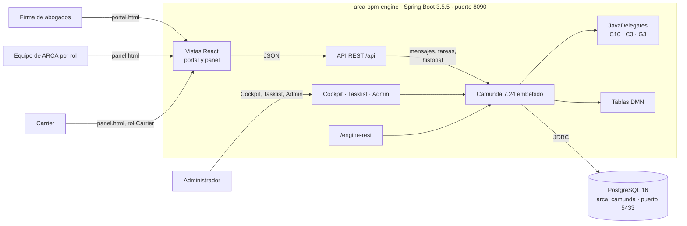

# ARCA · Hub del proyecto

**ARCA** es una aseguradora emergente que funciona como agencia general administradora (MGA) de un seguro de responsabilidad profesional. El seguro cubre a las firmas de abogados de EE. UU. frente a reclamaciones por errores cometidos al usar inteligencia artificial. Este hub reúne los repositorios del proyecto de semestre de *Software Basado en Procesos de Negocio* y explica cómo levantar y probar todo el sistema.

## Contexto y alcance

- **Problema:** las firmas usan IA para investigar, redactar y argumentar. Un error de esas herramientas puede terminar en una reclamación, y algunas pólizas existentes excluyen ese tipo de exposición.
- **Objetivo:** medir el riesgo de IA de cada firma con evidencia y orquestar con BPMN los procesos que llevan esa medición a una decisión de negocio:
  - suscribir o no a la firma;
  - atender un aviso de siniestro;
  - mantener el modelo de score.
- **Participantes:**
  - **Externos:** la firma de abogados y el carrier, que asume el riesgo y aprueba las versiones del modelo.
  - **Internos:** Jefe de Siniestros, Asesor Jurídico, Suscriptor, Actuario, Director de Suscripción, Ingeniero de Datos y Comité de Modelo.
- **Procesos incluidos:** C10 Registrar el aviso de siniestro, C3 Suscribir la solicitud y G3 Publicar una versión del modelo de score, con sus procesos invocados por Call Activity:
  - C10.1 Comunicar a la firma;
  - C1 Calcular el Pre-Score;
  - C3.1 Notificar la decisión al canal;
  - S2 Desplegar cambios en plataforma.
- **Fuera del alcance:** la emisión real de pólizas y el cobro, porque ARCA aún no tiene acuerdo con un carrier. También son simulados el escaneo con OpenAI, la búsqueda con Apify y el despliegue real del modelo. Las tareas automáticas reproducen esa lógica con datos de demostración.

## Integrantes y responsables

| Integrante | Código | Proceso a cargo | Código del proceso en `arca-bpm-engine` |
|---|---|---|---|
| Diego Alejandro Machado Tovar | 160005017 | C10 Registrar el aviso de siniestro | paquete `com.arca.c10`, modelos `procesos/c10` |
| Jesus Gregorio Delgado | 160005010 | C3 Suscribir la solicitud | paquete `com.arca.c3`, modelos `procesos/c3` |
| Johan Sebastian Forero Agudelo | 160005011 | G3 Publicar una versión del modelo de score | paquete `com.arca.g3`, modelos `procesos/g3` |

## Repositorios

| Componente | Repositorio | Propósito | Instrucciones |
|---|---|---|---|
| Hub | [DAMT777/arca-hub](https://github.com/DAMT777/arca-hub) | Guía general, arquitectura y enlaces a los componentes | Este README |
| Motor BPM y aplicaciones | [DAMT777/arca-bpm-engine](https://github.com/DAMT777/arca-bpm-engine) | Spring Boot con Camunda 7 embebido: despliega C10, C3 y G3 y sirve el portal de la firma, el panel interno y Cockpit | [README del motor](https://github.com/DAMT777/arca-bpm-engine#readme) |
| Procesos con Camunda Run | [yixx16/bpmn](https://github.com/yixx16/bpmn) | Modelos originales BPMN, DMN y formularios de cada proceso, sus workers en JavaScript, imágenes de los diagramas y la guía de demo con Camunda Run | [README de los procesos](https://github.com/yixx16/bpmn#readme) |

En este hub, cada componente es un submódulo de Git que aparece como una carpeta con el nombre del componente.

## Arquitectura



| Componente | Responsabilidad | Cómo se conecta |
|---|---|---|
| Portal de la firma | Reportar un siniestro (C10), solicitar la evaluación, responder el cuestionario (C3) y seguir el estado de cada solicitud | Llama a `/api/c10`, `/api/c3` y `/api/portal`. Esas rutas correlacionan los mensajes `AvisoReclamacion`, `CuestionarioIniciado` y `RespuestasCuestionarioRecibidas` |
| Panel interno | Bandeja de tareas por rol, formularios Camunda, inicio de G3 y respuesta del carrier | Llama a `/api/panel` (reclamar y completar tareas) y a `/api/g3` (mensajes `NecesidadNuevaVersion` y `RespuestaCarrier`) |
| API REST `/api` | Valida las entradas y traduce cada acción de las vistas en una operación del motor | Usa `RuntimeService`, `TaskService`, `FormService` y `HistoryService` |
| Motor Camunda 7 | Ejecuta los 7 procesos y las 3 decisiones DMN, maneja temporizadores, asignación por grupos e historial | Se despliega al arrancar con `@EnableProcessApplication` |
| JavaDelegates | Tareas automáticas de cada proceso: vigencia y expediente (C10), Pre-Score, puntaje y cotización (C3), validación, carrier y despliegue (G3) | `camunda:delegateExpression` en los BPMN |
| PostgreSQL | Guarda el runtime, el historial, los usuarios y los grupos del motor | Credenciales en `.env`. Se levanta con `docker compose` |
| Cockpit, Tasklist, Admin | Monitoreo de instancias y administración | `/camunda/app/` con el usuario administrador |

## Cómo levantar todo

**Requisitos:** Git, JDK 21 y Docker. Para la variante con Camunda Run, además Node.js 18 o superior.

1. Clonar el hub con sus componentes:

   ```bash
   git clone --recursive https://github.com/DAMT777/arca-hub.git
   ```

   Si ya lo habías clonado sin `--recursive`:

   ```bash
   git submodule update --init
   ```

2. Configurar y arrancar el motor, desde `arca-hub/arca-bpm-engine`:
   1. Copiar `.env.example` como `.env` y cambiar las contraseñas.
   2. Levantar la base de datos:

      ```bash
      docker compose up -d
      ```

   3. Arrancar la aplicación (en Windows: `mvnw.cmd spring-boot:run`):

      ```bash
      ./mvnw spring-boot:run
      ```

3. Abrir la aplicación:

| Qué | Dónde |
|---|---|
| Inicio | http://localhost:8090/ |
| Portal de la firma | http://localhost:8090/portal.html |
| Panel interno | http://localhost:8090/panel.html |
| Cockpit | http://localhost:8090/camunda/app/cockpit/default/ |

| Puerto | Servicio |
|---|---|
| 8090 | Aplicación Spring Boot con el motor (`ARCA_PORT`) |
| 5433 | PostgreSQL en Docker (`ARCA_DB_PORT`) |

Los usuarios de demo de cada rol, las variables de `.env` y los detalles de configuración están en el [README del motor](https://github.com/DAMT777/arca-bpm-engine#readme).

## Demostración de punta a punta

1. **C10:** en el portal, la firma reporta un siniestro. En el panel:
   1. El **Jefe de Siniestros** revisa el aviso. Con un monto de 250.000 USD o más, o con una exclusión dudosa, la DMN pide concepto jurídico.
   2. El **Asesor Jurídico** emite el concepto.
   3. El Jefe preverifica la cobertura.

   El portal muestra «Siniestro registrado» con el número de expediente, o «Aviso cerrado sin cobertura».
2. **C3:** en el portal, la firma solicita la evaluación y responde el cuestionario. Según el tier:
   - FORTRESS o FORTIFIED: se acepta sola.
   - GUARDED: decide el **Suscriptor**.
   - EXPOSED: pasa por el **Actuario** y luego el **Director de Suscripción**.
   - CRITICAL: se declina con plan de mejora.

   El portal muestra el tier, la decisión y la prima.
3. **G3:** en el panel:
   1. El **Actuario Jefe** inicia una nueva versión.
   2. El **Ingeniero de Datos** calibra.
   3. El Actuario documenta y el **Comité de Modelo** decide.
   4. El **Carrier** aprueba o rechaza.

   La tabla de versiones muestra si la versión se publicó o en qué evento terminó.
4. En **Cockpit** se sigue cada instancia y por dónde pasó.

El [README del motor](https://github.com/DAMT777/arca-bpm-engine#readme) detalla cada camino, incluidos los rechazos. También explica cómo adelantar los temporizadores de 24 horas y 15 días.

## Pruebas automáticas

Desde `arca-bpm-engine`:

```bash
./mvnw test
```

Arrancan el motor con H2 en memoria y comprueban el despliegue de los 7 procesos y las 3 decisiones, y un recorrido corto de C10.

## Mantener los submódulos al día

Cuando un componente recibe commits nuevos, el hub sigue apuntando al commit anterior hasta que se actualiza:

```bash
git submodule update --remote
```

```bash
git add arca-bpm-engine arca-procesos-camunda-run && git commit -m "Actualiza componentes"
```
