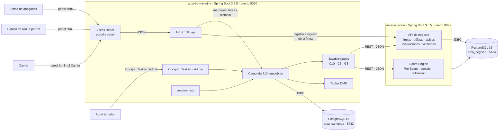

# ARCA · Hub del proyecto

**ARCA** es una aseguradora emergente que funciona como agencia general administradora (MGA) de un seguro de responsabilidad profesional. El seguro cubre a las firmas de abogados de EE. UU. frente a reclamaciones por errores cometidos al usar inteligencia artificial. Este hub reúne los repositorios del proyecto de semestre de *Software Basado en Procesos de Negocio* y explica cómo levantar y probar todo el sistema.

## Contexto y alcance

- **Problema:** las firmas usan IA para investigar, redactar y argumentar. Un error de esas herramientas puede terminar en una reclamación, y algunas pólizas existentes excluyen ese tipo de exposición.
- **Objetivo:** medir el riesgo de IA de cada firma con evidencia y orquestar con BPMN los procesos que llevan esa medición a una decisión de negocio:
  - suscribir o no a la firma;
  - atender un aviso de siniestro;
  - mantener el modelo de score.
- **Participantes:**
  - **Externos:**
    - **La firma de abogados.**
    - **El broker,** canal principal de venta de ARCA. En C3 comparte con la firma la piscina externa «Firma de abogados y broker» y recibe la decisión y las condiciones de suscripción por medio de C3.1 Notificar la decisión al canal.
    - **El carrier,** que asume el riesgo y aprueba las versiones del modelo.
  - **Internos:** Jefe de Siniestros, Asesor Jurídico, Suscriptor, Actuario, Director de Suscripción, Ingeniero de Datos y Comité de Modelo.
- **Procesos incluidos:** C10 Registrar el aviso de siniestro, C3 Suscribir la solicitud y G3 Publicar una versión del modelo de score, con sus procesos invocados por Call Activity:
  - C10.1 Comunicar a la firma;
  - C1 Calcular el Pre-Score;
  - C3.1 Notificar la decisión al canal;
  - S2 Desplegar cambios en plataforma.
- **Fuera del alcance:**
  - La emisión real de pólizas y el cobro, porque ARCA aún no tiene acuerdo con un carrier.
  - El portal del broker y su habilitación (S7 Habilitar brokers): en esta entrega el broker no tiene aplicación propia y la notificación de C3.1 se registra en el log del motor.
  - Son simulados el escaneo con OpenAI, la búsqueda con Apify, el backtesting y el despliegue real del modelo. Esos cálculos los hace arca-servicios con reglas de demostración y datos de ejemplo.

## Integrantes y responsables

| Integrante | Código | Proceso a cargo | En `arca-bpm-engine` | En `arca-servicios` |
|---|---|---|---|---|
| Diego Alejandro Machado Tovar | 160005017 | C10 Registrar el aviso de siniestro | paquete `com.arca.c10`, modelos `procesos/c10` | firmas, pólizas y avisos de siniestro |
| Jesus Gregorio Delgado | 160005010 | C3 Suscribir la solicitud | paquete `com.arca.c3`, modelos `procesos/c3` | Score Engine y evaluaciones |
| Johan Sebastian Forero Agudelo | 160005011 | G3 Publicar una versión del modelo de score | paquete `com.arca.g3`, modelos `procesos/g3` | versiones del modelo |

## Repositorios

| Componente | Repositorio | Propósito | Instrucciones |
|---|---|---|---|
| Hub | [DAMT777/arca-hub](https://github.com/DAMT777/arca-hub) | Guía general, arquitectura, casos de prueba y enlaces a los componentes | Este README |
| Motor BPM y aplicaciones | [DAMT777/arca-bpm-engine](https://github.com/DAMT777/arca-bpm-engine) | Spring Boot con Camunda 7 embebido: despliega C10, C3 y G3 y sirve el portal de la firma, el panel interno y Cockpit | [README del motor](https://github.com/DAMT777/arca-bpm-engine#readme) |
| Servicios de negocio | [DAMT777/arca-servicios](https://github.com/DAMT777/arca-servicios) | Servicio REST con su propia base de datos: firmas, pólizas, avisos, evaluaciones, versiones del modelo y el Score Engine | [README de los servicios](https://github.com/DAMT777/arca-servicios#readme) |
| Procesos con Camunda Run | [yixx16/bpmn](https://github.com/yixx16/bpmn) | Modelos originales BPMN, DMN y formularios de cada proceso, sus workers en JavaScript, imágenes de los diagramas y la guía de demo con Camunda Run | [README de los procesos](https://github.com/yixx16/bpmn#readme) |

En este hub, cada componente es un submódulo de Git que aparece como una carpeta con el nombre del componente.

## Arquitectura



| Componente | Responsabilidad | Cómo se conecta |
|---|---|---|
| Portal de la firma | Registro e ingreso de la firma, reporte de siniestros (C10), evaluación y cuestionario (C3), historial con el estado de cada solicitud | Llama a `/api/portal`, `/api/c10` y `/api/c3`. Esas rutas correlacionan los mensajes `AvisoReclamacion`, `CuestionarioIniciado` y `RespuestasCuestionarioRecibidas` |
| Panel interno | Bandeja de tareas por rol, formularios Camunda, inicio de G3 y respuesta del carrier | Llama a `/api/panel` (reclamar y completar tareas) y a `/api/g3` (mensajes `NecesidadNuevaVersion` y `RespuestaCarrier`) |
| API REST `/api` | Valida las entradas y traduce cada acción de las vistas en una operación del motor | Usa `RuntimeService`, `TaskService`, `FormService` y `HistoryService`; el registro de la firma lo delega en arca-servicios |
| Motor Camunda 7 | Ejecuta los 7 procesos y las 3 decisiones DMN, maneja temporizadores, asignación por grupos e historial | Se despliega al arrancar con `@EnableProcessApplication` |
| JavaDelegates | Tareas automáticas de cada proceso | `camunda:delegateExpression` en los BPMN. Invocan a arca-servicios con `ServiciosArca` (cliente REST) y guardan la respuesta como variables del proceso |
| arca-servicios | Datos del negocio y Score Engine | API REST en el puerto 8091 |
| PostgreSQL del motor | Runtime, historial, usuarios y grupos de Camunda | Base `arca_camunda` en el puerto 5433 |
| PostgreSQL del negocio | Firmas, pólizas, avisos, evaluaciones y versiones, cada registro con la clave de negocio y el id de su instancia | Base `arca_negocio` en el puerto 5434; se crea y se llena con `schema.sql` y `data.sql` |
| Cockpit, Tasklist, Admin | Monitoreo de instancias y administración | `/camunda/app/` con el usuario administrador |

### Qué aplicación atiende cada parte del proceso

| Proceso | Elemento del BPMN | Quién lo atiende | Aplicación |
|---|---|---|---|
| C10 | Evento de inicio «Aviso de reclamación recibido» | Firma | Portal → pestaña **Reportar siniestro** |
| C10 | Enviar el acuse · Verificar la vigencia · Recuperar la póliza | Motor | JavaDelegates → arca-servicios (avisos y pólizas) |
| C10 | DMN «¿Requiere concepto jurídico?» | Motor | Tabla DMN |
| C10 | Revisar el aviso · Determinar la preverificación | Jefe de Siniestros | Panel interno |
| C10 | Emitir el concepto jurídico | Asesor Jurídico | Panel interno |
| C10 | Temporizador de 24 h · Informar el estado | Motor | JavaDelegate |
| C10 | Abrir el expediente · Registrar sin cobertura · C10.1 Comunicar | Motor | JavaDelegates → arca-servicios (expediente y estado del aviso) |
| C10 | Seguimiento del aviso | Firma | Portal → **Mis solicitudes** |
| C3 | Evento de inicio «Firma inicia el cuestionario» | Firma | Portal → pestaña **Evaluar mi firma** |
| C3 | C1: Escanear la web · Buscar abogados · Calcular el Pre-Score | Motor | JavaDelegates → arca-servicios (firmas y Score Engine) |
| C3 | Presentar el cuestionario | Motor | JavaDelegate → arca-servicios (registra la evaluación) |
| C3 | Recibir respuestas y declaración de veracidad | Firma | Portal → modal del cuestionario |
| C3 | Calcular el puntaje · DMN «Ruta de suscripción» | Motor | Score Engine y tabla DMN |
| C3 | Revisar el caso y decidir | Suscriptor | Panel interno |
| C3 | Analizar el caso y recomendar condiciones | Actuario | Panel interno |
| C3 | Resolver el caso (revisión senior) | Director de Suscripción | Panel interno |
| C3 | Cotización · Plan de mejora · Registrar la decisión | Motor | JavaDelegates → Score Engine y evaluaciones |
| C3 | C3.1 Notificar la decisión al canal | Motor; el destinatario es el broker | JavaDelegate. El broker no tiene aplicación propia en este alcance |
| C3 | Resultado: tier, decisión, prima o reevaluación | Firma | Portal → **Mis solicitudes** |
| G3 | Evento de inicio «Necesidad de una nueva versión» | Actuario Jefe | Panel interno → **Nueva versión del modelo** |
| G3 | Consolidar la evidencia · Documentar la memoria | Actuario Jefe | Panel interno |
| G3 | Calibrar la rúbrica y los pesos | Ingeniero de Datos | Panel interno |
| G3 | Validar la versión · DMN de validación | Motor | JavaDelegate → arca-servicios (backtesting) y tabla DMN |
| G3 | Revisar y aprobar la versión | Comité de Modelo | Panel interno |
| G3 | Someter al carrier · S2 Desplegar · Registrar la vigencia | Motor | JavaDelegates → arca-servicios (versiones) |
| G3 | Respuesta del carrier | Carrier | Panel interno → rol **Carrier** |
| Todos | Monitoreo de instancias, variables e incidentes | Administrador | Cockpit |

## Persistencia

Hay dos bases de datos, cada una con su responsabilidad:
- **`arca_camunda`** (motor): el estado de los procesos y su historial. La crea Camunda al arrancar.
- **`arca_negocio`** (arca-servicios): el modelo de datos del negocio. Lo crean `schema.sql` y `data.sql` en cada arranque, sin duplicar datos.

Cada aviso, evaluación y versión guarda la clave de negocio (`AV-…`, `EV-…`, `VM-…`), que es la misma que muestran el portal y el panel, y el id de su instancia en Camunda. El modelo de datos, las firmas de ejemplo y cómo consultar los registros durante la demostración están en el [README de los servicios](https://github.com/DAMT777/arca-servicios#readme).

## Cómo levantar todo

**Requisitos:** Git, JDK 21, Docker y Node.js 18 o superior (solo para el script de casos de prueba y la variante con Camunda Run).

1. Clonar el hub con sus componentes:

   ```bash
   git clone --recursive https://github.com/DAMT777/arca-hub.git
   ```

   Si ya lo habías clonado sin `--recursive`:

   ```bash
   git submodule update --init
   ```

2. **Primero arca-servicios**, desde `arca-hub/arca-servicios`:
   1. Copiar `.env.example` como `.env` y cambiar `SERVICIOS_DB_PASSWORD`.
   2. Levantar su base de datos:

      ```bash
      docker compose up -d
      ```

   3. Arrancar el servicio (en Windows: `mvnw.cmd spring-boot:run`):

      ```bash
      ./mvnw spring-boot:run
      ```

3. **Después el motor**, en otra terminal, desde `arca-hub/arca-bpm-engine`:
   1. Copiar `.env.example` como `.env` y cambiar las tres contraseñas.
   2. Levantar su base de datos:

      ```bash
      docker compose up -d
      ```

   3. Arrancar la aplicación:

      ```bash
      ./mvnw spring-boot:run
      ```

4. Abrir la aplicación:

| Qué | Dónde |
|---|---|
| Inicio | http://localhost:8090/ |
| Portal de la firma | http://localhost:8090/portal.html |
| Panel interno | http://localhost:8090/panel.html |
| Cockpit | http://localhost:8090/camunda/app/cockpit/default/ |
| API de arca-servicios | http://localhost:8091/api/firmas |

| Puerto | Servicio | Variable |
|---|---|---|
| 8090 | Motor y aplicaciones | `ARCA_PORT` |
| 8091 | arca-servicios | `SERVICIOS_PORT`; el motor lo busca en `ARCA_SERVICIOS_URL` |
| 5433 | PostgreSQL del motor | `ARCA_DB_PORT` |
| 5434 | PostgreSQL del negocio | `SERVICIOS_DB_PORT` |

Los usuarios de demo de cada rol y las demás variables están en el README de cada componente.

## Demostración de punta a punta

1. **C10:** en el portal, ingresa con `riesgos@smithlee.com` y reporta un siniestro sobre la póliza `POL-2026-0042`. En el panel:
   1. El **Jefe de Siniestros** revisa el aviso, con el límite y las exclusiones que trajo arca-servicios. Con un monto de 250.000 USD o más, o con una exclusión dudosa, la DMN pide concepto jurídico.
   2. El **Asesor Jurídico** emite el concepto.
   3. El Jefe preverifica la cobertura.

   El portal muestra «Siniestro registrado» con el número de expediente, que asigna arca-servicios. Con una fecha anterior a la vigencia, o con la póliza de otra firma, el aviso se cierra sin cobertura.
2. **C3:** en el portal, registra una firma nueva o ingresa con una de ejemplo. Solicita la evaluación y responde el cuestionario. El Score Engine calcula el Pre-Score y el puntaje, y la DMN elige la ruta:
   - FORTRESS o FORTIFIED: se acepta sola.
   - GUARDED: decide el **Suscriptor**.
   - EXPOSED: pasa por el **Actuario** y luego el **Director de Suscripción**.
   - CRITICAL: se declina con plan de mejora.

   Rivera & Cole, que tiene una restricción disciplinaria, siempre pasa a revisión humana.
3. **G3:** en el panel:
   1. El **Actuario Jefe** inicia una nueva versión.
   2. El **Ingeniero de Datos** calibra.
   3. arca-servicios ejecuta el backtesting.
   4. El Actuario documenta y el **Comité de Modelo** decide.
   5. El **Carrier** aprueba o rechaza.

   La versión publicada queda vigente y la anterior, reemplazada.
4. En **Cockpit** se sigue cada instancia; en `arca_negocio`, los registros que dejó.

## Pruebas

| Qué | Cómo | Resultado |
|---|---|---|
| 25 casos de punta a punta (principal, alternativos y excepciones de C10, C3 y G3) | Con los dos componentes en marcha, desde este hub: `node pruebas/casos.mjs` | [docs/casos-de-prueba.md](docs/casos-de-prueba.md): 25 de 25 con el resultado esperado |
| Pruebas automáticas del motor | `./mvnw test` en `arca-bpm-engine` | 4 pruebas con H2 y un doble de arca-servicios |
| Pruebas automáticas de arca-servicios | `./mvnw test` en `arca-servicios` | 6 pruebas con H2 en modo PostgreSQL |

## Mantener los submódulos al día

Cuando un componente recibe commits nuevos, el hub sigue apuntando al commit anterior hasta que se actualiza:

```bash
git submodule update --remote
```

```bash
git add arca-bpm-engine arca-servicios arca-procesos-camunda-run && git commit -m "Actualiza componentes"
```
